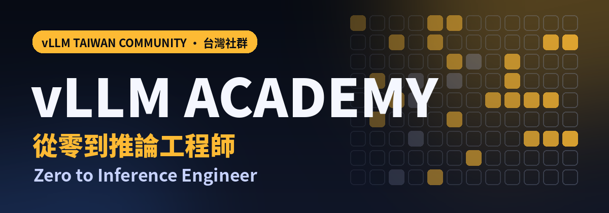
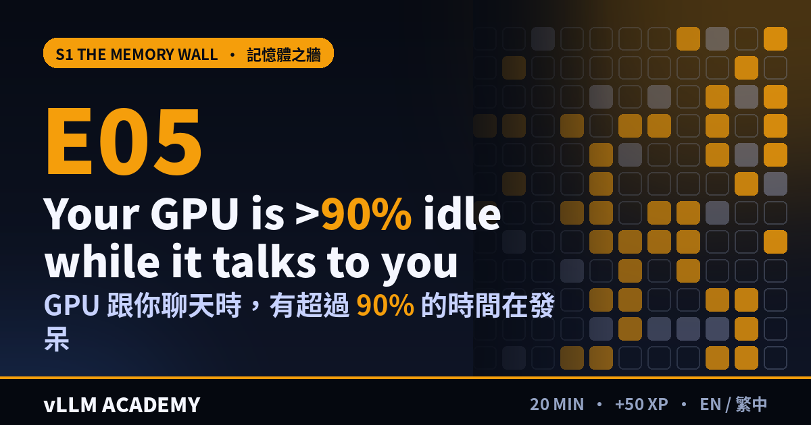
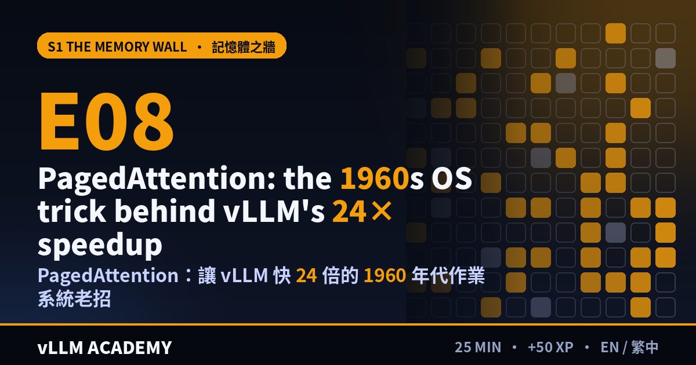
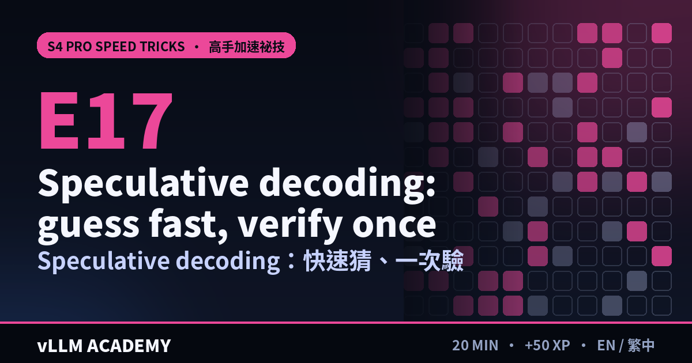
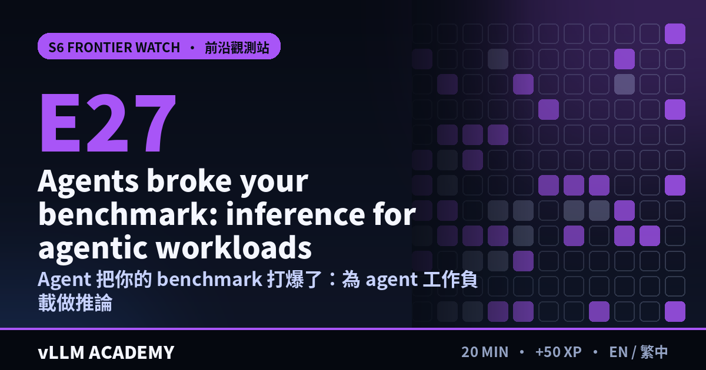
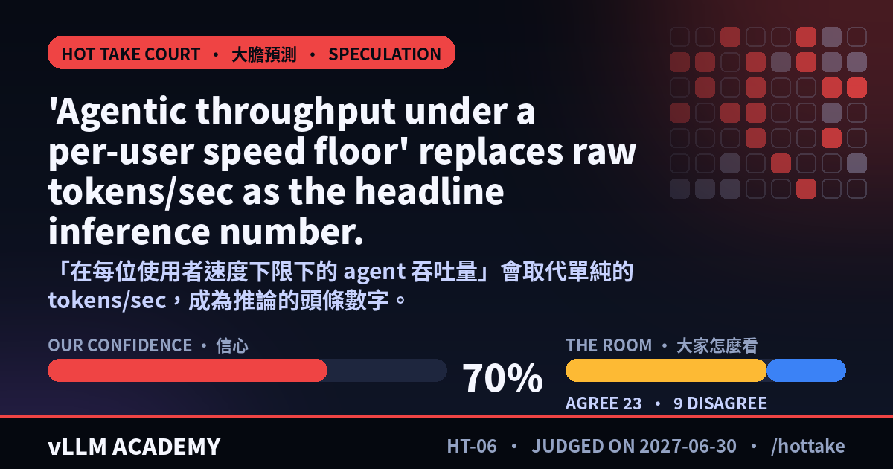
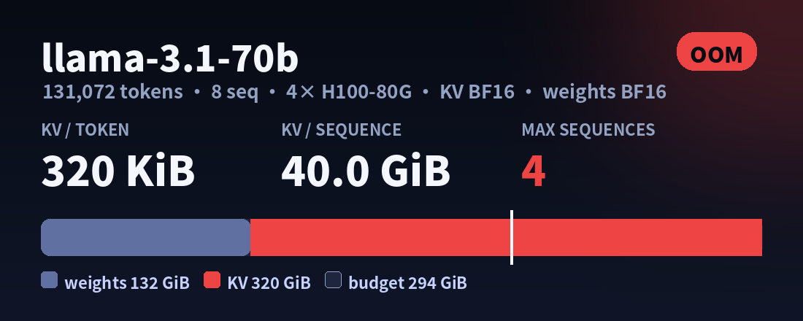
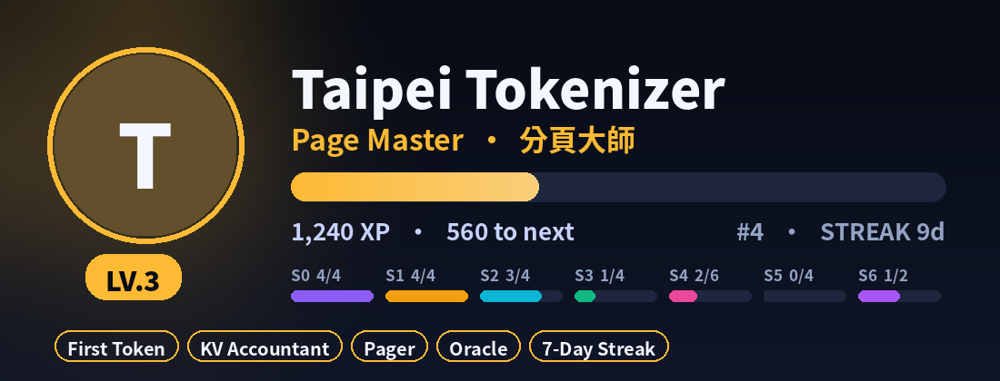

<p align="center"></p>

<h1 align="center">vLLM Academy Quest</h1>
<p align="center"><b>搞懂 ChatGPT 這類模型到底怎麼跑起來。親手打造引擎。送出被 merge 的 PR。拿到 offer。</b><br>
28 集短課程 · 9 個實作關卡 · 會出題、會打分、會幫你升級的 Discord 機器人 · 繁體中文 + English</p>
<p align="center"><a href="README.md">English</a> · <a href="CURRICULUM.zh-TW.md">課綱</a> · <a href="../discord_bot/README.md">架設 Discord 機器人</a> · <a href="labs/">實作關卡</a></p>

---

## 為什麼是這個？為什麼是現在？

- **現在「跑」模型的花費，已經比「訓練」模型還多。** 訓練只做一次；推論在每個人每次按下 Enter 時都會發生。能讓推論又快又便宜的人，是 AI 領域最搶手的工程師之一。
- **vLLM 是業界最多人在用的推論引擎。** 300 多位貢獻者大約每兩週發一個版本（v0.31.0 在 2026 年 10 月 5 日發布，307 人貢獻了 717 個 commit）。它的創作者在 2026 年 1 月為 Inferact 募得 1.5 億美元種子輪，由 a16z 與 Lightspeed 共同領投。[來源](https://techcrunch.com/2026/01/22/inference-startup-inferact-lands-150m-to-commercialize-vllm/)
- **機櫃是台灣做的，但誰來把模型服務好？** 全世界很多 AI 伺服器出自台灣的產線，而能讓模型在這些硬體上跑得飛快的人，比硬體本身稀有得多。TAIONE 與 Embedded LLM 在 2026 年 8 月啟動了 vLLM Fellowship Track。[來源](https://macaubusiness.com/taione-open-source-foundation-and-embedded-llm-collaborate-to-build-taiwans-vllm-ecosystem/)

## 60 秒上手（不用 GPU、不用安裝）

```bash
git clone https://github.com/tjtanaa/vllm-academy.git && cd vllm-academy
python academy/labs/paged_playground.py --scenario prefix   # 看兩段對話共用 KV block
python academy/labs/batching_arena.py                       # static vs continuous batching 正面對決
python academy/labs/kv_budget.py --model llama-3.1-70b --context 131072 --gpus 4   # 經典面試題
```

只要 Python 3.10+ 和標準函式庫。每個實作檢查點的數字都是固定的，你馬上就知道自己有沒有做對。

## 七季內容

<table>
<tr>
<td width="50%"></td>
<td width="50%"></td>
</tr>
<tr>
<td></td>
<td></td>
</tr>
</table>

| | 季 | 學完你能… |
|---|---|---|
| 🔤 | **S0 你好，Token** · E01–E04 | 解釋 token、attention，以及為什麼推論 ≠ 訓練 |
| 🧱 | **S1 記憶體之牆** · E05–E08 | 心算 KV cache，講清楚 PagedAttention |
| 🛠️ | **S2 親手打造 mini-vLLM** · E09–E12 | 實作 continuous batching、prefix caching、chunked prefill，並通過 30 個測試 |
| 🧭 | **S3 vLLM 原始碼探險** · E13–E16 | 在真正的程式碼裡，追蹤一個請求從 HTTP 到 GPU 再回來 |
| 🚀 | **S4 高手加速祕技** · E17–E22 | 聊推測解碼、FP8/FP4、TP/PP/EP、P/D 分離、KV offload 與 RL |
| 🏆 | **S5 上 PR、拿 Offer** · E23–E26 | 送出 PR、誠實做 benchmark、掌握系統設計面試 |
| 🔮 | **S6 前沿觀測站** · E27–E28+ | *每月更新的活季度：* agent 推論、冷啟動，以及接下來推出的新東西 |

每一集都是同樣五個節拍：**🎣 鉤子 → 💡 頓悟 → 🧪 動手做 → 🎤 用專業的方式說出來 → 🏁 小測驗。** 完整內容請看[課綱](CURRICULUM.zh-TW.md)。

## 實作關卡

| 關卡 | 需要 | 時間 |
|---|---|---|
| [Q1 第一個 Token](labs/Q1-first-token.zh-TW.md)：架自己的 vLLM 伺服器、看 token 串流 | 免費 Colab GPU | 15 分鐘 |
| [Q2 分頁遊樂場](labs/Q2-paged-playground.zh-TW.md)：分頁、共用、offload、agent | 只要 Python | 15 分鐘 |
| [Q3 批次競技場](labs/Q3-batching-arena.zh-TW.md)：roofline + 排程器大賽 | 只要 Python | 15 分鐘 |
| [Q4 KV 預算](labs/Q4-kv-budget.zh-TW.md)：讓多數人陣亡的記憶體計算 | 只要 Python | 10 分鐘 |
| [Q5 打造 mini-vLLM](labs/Q5-build-mini-vllm.zh-TW.md)：魔王關，30 個測試 | CPU + PyTorch | 4–8 小時 |
| [Q6 原始碼尋寶](labs/Q6-codebase-hunt.zh-TW.md)：在真正的 vLLM 裡解 14 題 | git | 45 分鐘 |
| [Q7 像專家一樣做 Benchmark](labs/Q7-benchmark-like-a-pro.zh-TW.md)：一份誠實的 A/B 報告 | 1 張 GPU | 45 分鐘 |
| [Q8 第一個 PR](labs/Q8-first-pr-quest.zh-TW.md)：從 fork 到 merge | Linux/macOS | 2 小時 + 審查時間 |
| [Q9 模擬面試](labs/Q9-mock-interview.zh-TW.md)：每週練習 | Discord | 30 分鐘 |

在 Discord 用 `/lab`，機器人會一步一步帶你做。

## Discord 機器人

<table>
<tr>
<td width="50%"><br><b>🔮 大膽預測法庭</b>：附日期的預測，寫出我們的信心、證據，以及什麼情況代表我們錯了。投 🔥/🧊，判決日一到，我們公開幫自己打分數。</td>
<td width="50%"><br><b>🧮 /kvcalc</b>：任何模型、任何 GPU，「放得下嗎？」一秒算給你看，公式也一起秀出來。學到的是算法，不只是答案。</td>
</tr>
<tr>
<td colspan="2"><br><b>🏅 /profile</b>：從 <i>Token 新手</i> 一路升到 <i>準維護者</i>，還有每季進度、連續天數與徽章（包含上游 PR 被 merge 時頒發的 <b>已合併</b> 徽章）。</td>
</tr>
</table>

| 學習 | 練習 | 探索 | 社群 |
|---|---|---|---|
| `/start` `/path` `/episode` `/lab` `/lang` | `/quiz` `/interview` `/mock` `/hunt` `/kvcalc` | `/trace` `/code` `/glossary` `/trends` `/hottake` | `/profile` `/leaderboard` `/career` `/community` `/events` `/gfi` |

另外還有台北時間每晚 20:00 的雙語**每日一練**（週五是大膽預測日，跟 vLLM Weekly 電子報同一天），以及**版本雷達**：每次 vLLM 發新版，就告訴你該複習哪幾集。[10 分鐘架好機器人 →](../discord_bot/README.md)

## 選一條路線

🌱 **好奇寶寶**：ChatGPT 怎麼運作？ · 🎓 **求職衝刺**：完整路線加每週模擬面試 · 🛠️ **貢獻者**：直衝原始碼和 PR · ⚡ **服務工程師**：生產環境加速祕技 · ⏱️ **面試速通**：7 天 10 集

## 誠實原則

標題可以大膽，內容必須誠實。任何速度數字都要說清楚*和什麼比、在什麼工作負載下*。維護者還沒實際跑過的 GPU 指令會標註清楚。趨勢卡片附上日期與來源。大膽預測一律標示為**推測**，附上信心與判決日，並公開打分數。所有內容的深入嚴謹版本，都在 [Phase 1](../phase1/README.md)。

## 一起貢獻

發現數字寫錯？有更好的鉤子？想新增尋寶題、測驗或前沿單集？內容都是 [`content/`](content/) 裡的 YAML，以及 [`labs/`](labs/) 與 [`frontier/`](frontier/) 裡的 Markdown，在 `discord_bot/` 目錄下執行 `python -m academy_bot --check` 就能驗證。歡迎開 PR，詳見 [CONTRIBUTING](../CONTRIBUTING.md)。

<sub>這是獨立的社群專案，不是 vLLM 官方課程。vLLM 屬於 vLLM 團隊與所有貢獻者。</sub>
